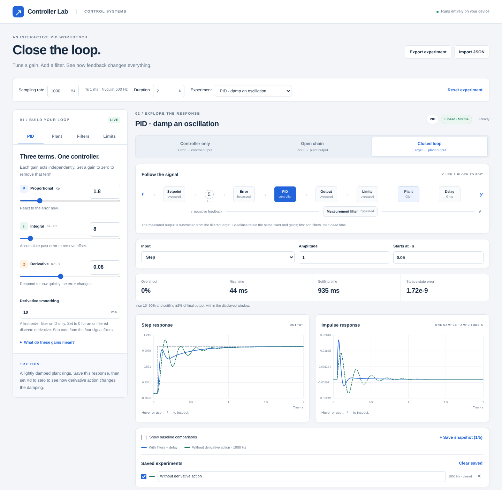

# Controller Lab

An interactive, offline workbench for designing and understanding PID controllers,
digital filters, plant dynamics and feedback. Built in the style of
[Filter Lab](https://github.com/koenig-arthur/filter-lab), with compatible filter imports.

[](docs/controller-lab-preview.pdf)

*Adding derivative action (solid blue) reduces the ringing visible in the response without it (dashed green).*
[View the full PDF preview](docs/controller-lab-preview.pdf).

## Run locally

Open **index.html** in a modern browser. No build, server, account, CDN or runtime
internet connection is needed. Keep `index.html`, `style.css`, `dsp.js`,
`control.js`, `plots.js`, `app.js`, `license.html` and `LICENSE` together.

The application needs only those local files. Node and npm are optional development
tools, used for testing. All settings stay in the current page session; export an
experiment to keep it between sessions.

## Start with an experiment

The default is a PI controller (`Kp = 1`, `Ki = 10 s⁻¹`, `Kd = 0`) controlling a
unity-gain, 100 ms first-order plant at 1 kHz. Change a gain using a slider or numeric
field; fields also accept signed values outside the initial slider range. Setting
a gain to zero removes that branch and its states.

Try the built-in experiments:

- **P · steady-state offset:** with `Kp = 1`, the final output is 0.5 for a unit target.
- **PI · 100 ms plant:** integral action removes that steady-state offset.
- **PID · damp an oscillation:** compare an oscillating plant with and without D.
- **D · derivative kick:** inspect the spike caused by a sudden error change.
- **Filters · the cost of smoothing:** see how measurement filtering adds loop lag.
- **Delay · lose stability:** compare identical gains and plant dynamics with and without dead time.
- **Limits · windup recovery:** an unreachable target steps down; toggle anti-windup to compare recovery.

Reset restores the selected preset; a custom experiment resets to the default PI
example. Saved comparisons are retained until removed or the page is closed.

## Three views

| View | Input → output | Active blocks |
| --- | --- | --- |
| Controller only | Imposed error → control output | Error filter, PID, output filter, limits |
| Open chain | Imposed input → plant output | Setpoint filter, error filter, PID, output filter, limits, plant, delay |
| Closed loop | Target → plant output | All blocks, with negative measurement feedback |

Click a block in the signal diagram to edit it. Blocks outside the current view
are marked inactive. The controller view compares raw PID with the configured
filtered/limited controller. The other views compare PID + plant, then filters,
then additional dead time. These baselines always retain the same plant dynamics
and gains; actuator limits remain the same except in the raw-controller baseline.

Both step and impulse responses are shown. The input selector chooses the signal
for the live control-effort, P/I/D and error plots. Recovery replaces the step
plot with a step-up/step-down response. A digital impulse is **one sample of the
chosen amplitude**, not a unit-area continuous impulse. All states start at zero.

Hover a plot or focus it and use the arrow keys to inspect values. Frequency axes
are logarithmic in Hz and stop at the live model's Nyquist frequency. Saved curves
retain their own sampling rates; they are never extrapolated beyond their Nyquist
limits. Time plots retain each experiment's duration.

## Plant models, lag and dead time

Built-in plants include static gain, first-order lag, a damped second-order system,
and an integrator. The second-order frequency is the undamped natural frequency
in Hz; the damping ratio is dimensionless.

**Time constant and dead time are different.** A first-order plant with `τ = 100 ms`
reaches about 63.2% of its final response after 100 ms. An additional 100 ms dead time
shifts the response by 100 ms. Dead time is rounded to the nearest sample, and both
the sample count and effective duration are displayed. No extra computational
delay is inserted by the simulator.

Custom plants accept:

- **G(s):** numerator and denominator coefficients in descending powers of `s`.
  For `1 / (0.1s + 1)`, enter numerator `1`, denominator `0.1, 1`.
  Proper continuous transfer functions through order eight are supported.
- **G(z):** coefficients of `1, z⁻¹, z⁻², …`, as in Filter Lab. Leading numerator
  zeros represent sample delays. Each custom digital model supports order 64.

Continuous plants are discretized using a zero-order hold. Their physical
parameters remain unchanged when sampling rate changes. Time-domain simulation
and frequency evaluation use the discretized state-space realization, avoiding
unnecessary high-order polynomial expansion. Expanded coefficients remain
available for inspection, with a warning when their precision is insufficient
for reliable polynomial stability analysis.

## Filters and pasted difference equations

Each of the four filter positions has its own enable switch and parameters:

- **Setpoint:** shapes the target before the error is formed.
- **Error:** filters the error before all PID terms.
- **Output:** filters the PID output before the actuator limiter.
- **Measurement:** filters the measured output inside negative feedback.

Design IIR biquads or FIR low-pass, high-pass, band-pass and notch/band-stop filters,
use a moving average, enter `H(z)` or coefficient lists, import Filter Lab JSON,
or paste a difference equation. Preview first, review the coefficients, then click
**Apply & enable filter**. Changing an input method or editing a draft does not
silently replace the applied filter.

For example, paste:

```text
y[n] = 0.96585·x[n] − 1.3659·x[n−1] + 0.96585·x[n−2] + 1.3659·y[n−1] − 0.9317·y[n−2]
```

It becomes:

```text
b = [0.96585, -1.3659, 0.96585]
a = [1, -1.3659, 0.9317]
```

Feedback terms change sign when moved into the denominator. The parser accepts
`·`, `×`, `*`, Unicode minus, ASCII minus, whitespace and scientific notation.
It accepts linear sums of current/past input and past output samples only.
Future samples, nonlinear expressions and executable code are rejected.

A pasted equation uses the **current lab sampling rate**. Pasting rounded values
uses exactly those values; JSON is preferred for full precision. Filter Lab JSON
has the existing shape:

```json
{"version":1,"b":[0.5,0.5],"a":[1],"sampleRate":1000}
```

When an imported rate differs, explicitly choose to adopt it for the whole lab
or reinterpret the coefficients at the current rate. On later rate changes,
coefficient filters retain their coefficients; designed filters retain their
specified frequencies in Hz and are redesigned. Invalid edits leave the last
valid model and plots in place.

The filter core is reused from Filter Lab: FIR designs use an odd 3–63 tap Hamming
windowed sinc; IIR designs are second-order biquads. Moving averages support 1–65
samples. Custom coefficients and equations support order 64. FIR cutoff is
approximately −6 dB, while a biquad low/high-pass has −3 dB cutoff at
`Q = 1/√2`. Inspect the achieved frequency response for narrow FIR transitions.

## PID, limits and numerical conventions

The parallel PID uses seconds for time, independently of the displayed millisecond
controls. With `e[n]` the filtered error, `Ts = 1/fs`, and derivative smoothing `Tf`:

```text
P[n]   = Kp e[n]
D[n]   = Tf/(Tf+Ts) D[n−1] + Kd/(Tf+Ts) (e[n]−e[n−1])
u[n]   = P[n] + I[n] + D[n]
I[n+1] = I[n] + Ki Ts e[n]
```

`Tf = 0` is the unfiltered backward-difference derivative. D acts on error, so
setpoint changes can cause derivative kick. Derivative smoothing affects only D
and is separate from the four signal filters.

The optional actuator limiter follows the output filter. When enabled,
back-calculation adds this correction to `I[n+1]`:

```text
(Ts / trackingTime) × (clipped actuator command − unclipped filtered command)
```

Tracking time must be at least one sample interval. With `Ki = 0`, the integrator
and anti-windup contribution are both absent. This corrects PID integrator windup;
it does not reset internal states of arbitrary output filters. Direct-feedthrough
feedback is solved at the current sample, including the clipping branches. Singular
linear feedback and nonunique nonlinear solutions are explicitly reported.

**Linear stability** describes the complete unsaturated realization, including
uncancelled hidden modes and setpoint-filter states. It is not inferred from a
bounded simulation. Pole-zero cancellations are not used to hide unstable modes.
Frequency curves for unstable systems are algebraic unit-circle evaluations.
The Schur reduction uses 80-digit fixed-point arithmetic; pole locations use the
verified Filter Lab root solver plus a root-sensitivity check. Ill-conditioned
models are labeled uncertain, not declared stable from an unreliable plot.

Limits:

- Combined active realization: **512 states**. Delay states are separate from the
  per-filter order limit, so 100 ms at 1 kHz is supported.
- Pole plotting: **64 states**. Larger models retain their Schur analysis and responses.
- Simulation: **100,000 samples**, including the initial sample.
- Divergence: stop before nonfinite values or any monitored magnitude above `1e9`.
- Unit-circle radii within `1e-8` are treated as boundary cases when roots are reliable.

Step metrics use the final output: rise time is 10–90%, overshoot is relative to
that final value, and settling is within ±2%. In the closed-loop view, steady-state
error compares the unfiltered target with the final output; the other views show
final output instead. Settling is only assessed over the
displayed window. For nonlinear simulations, an observed final plateau is estimated
from the final 10% of samples and explicitly labeled; it is not a stability proof.
Metrics are unavailable for impulses, recovery signals, divergent traces or
unverified linear convergence.

## Save, compare and export

Save up to five complete experiment snapshots, rename them, hide them or remove
them. Snapshots from other views remain saved but are only plotted when that view
is selected. Exports include the live configuration and all saved comparisons:

```text
{ kind: "controller-lab", version: 1, config: { … }, comparisons: [ … ] }
```

**Export traces · CSV** downloads step/recovery and impulse traces for every
currently plotted experiment. Columns include time in seconds, input, filtered
reference, output, measurement, controller error, filtered error, P/I/D terms,
raw PID output, filtered command, clipped actuator command and tracking error.

## Development and tests

With Node.js 20+ and npm:

```sh
npm ci
npx playwright install chromium --only-shell
npm test
npm run test:browser
```

The numerical suite uses Node's built-in test API and checked-in independent
SciPy fixtures. It covers continuous/discrete plants, all four filter positions,
PID branches, feedback timing, delay, stability, singular loops, saturation,
anti-windup, equation parsing, JSON and CSV. Reference generation is optional:

```sh
python3 tests/generate_references.py  # requires NumPy and SciPy
```

Browser tests load the real `file://` application with network access disabled.
They exercise all views and filter methods, imports, rate mismatches, snapshots,
exports, cancellation, keyboard controls and mobile layout. They fail on browser
console errors or attempted HTTP requests. Failure artifacts are ignored under
`test-results/`. Set `PLAYWRIGHT_BROWSERS_PATH` for a custom browser cache.

Source layout:

- `dsp.js`: standalone Filter Lab parser, filter designers and complex/root math.
- `control.js`: pure model compilation, ZOH, stability, simulation, metrics and serialization;
  exports `ControlLab` in the browser and CommonJS in Node.
- `plots.js`: SVG plotting and pointer/keyboard inspection.
- `app.js`: editor state, cancellable simulation scheduling and local-file import/export.

The engine exposes `defaults()`, `compile(config)`, `analyze(model)`,
`simulate(model, excitation)`, `createSimulation(model, excitation)` for incremental
execution, `frequencyAt(model, hz)`, `frequency(model)`, `parseEquation(text, fs)`,
and experiment/filter import/export helpers. No DOM is required by the engine.

## References and license

- [SciPy cont2discrete](https://docs.scipy.org/doc/scipy/reference/generated/scipy.signal.cont2discrete.html): zero-order-hold conversion.
- [MathWorks anti-windup examples](https://www.mathworks.com/help/simulink/slref/anti-windup-control-using-a-pid-controller.html): saturation and integrator recovery.
- [First-order plus dead-time model](https://apmonitor.com/pdc/index.php/Main/FirstOrderSystems): time constant versus dead time.
- [W3C Audio EQ Cookbook](https://www.w3.org/TR/audio-eq-cookbook/): biquad filter formulas used by Filter Lab.

Copyright (C) 2026 koenig-arthur. Original source, documentation and fixtures are
licensed **GPL-3.0-only**, including the reused Filter Lab DSP code and visual
conventions. See [LICENSE](LICENSE) or the [offline license page](license.html).
Provided without warranty. Development dependencies retain their own licenses.
